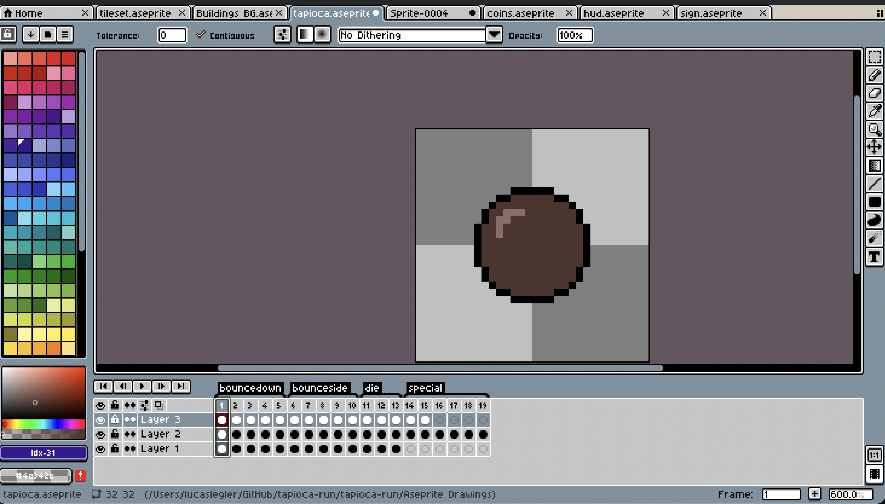

# Tapioca Run  

A game made for Hackclub Haven, with the theme of "bounce back". It is a relatively simple parkour game/platformer, featuring 3 different pearls, with different abilities, art made in aseprite, and sounds from pixabay.com. The different pearls are default, sugar, and pop. Default  is, well, default. pop gives you a double jump and represents popping boba. sugar gives wall climb, with a cooldown of 2 seconds per use. You start the game, only able to survive for 15 bounces, then you buy upgrades from the shop with the coins you collect, including more bounce time, and new pearls.   
Art made in aseprite:  
    
